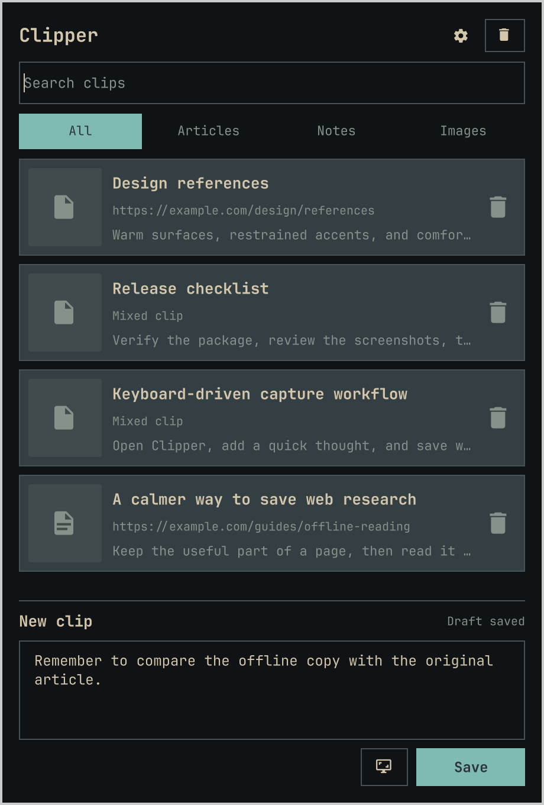
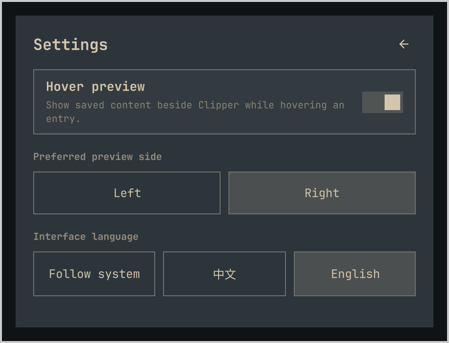
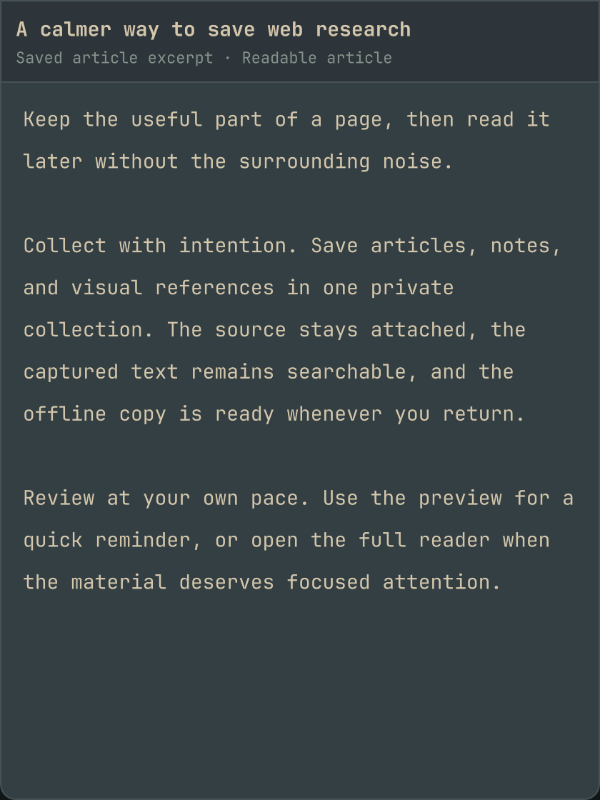

# Omarchy Clipper

English | [简体中文](README.zh-CN.md)

Omarchy Clipper saves mixed text and image clips from the Omarchy bar. Its
browser extension can capture readable articles, repository README files,
forum pages, selections, and screenshots. Captured articles remain available
for offline reading after capture.

> Source release candidate. Clipper is not yet listed in the Omarchy Marketplace.

[Install](#add-build-and-install) · [Usage](#usage) · [Settings](#settings) · [Compatibility](#compatibility-and-validation) · [Update](#update) · [Uninstall](#uninstall)

## Screenshots

Actual application views with synthetic sample content; no personal collection data is shown.

### Collection



### Settings



### Hover preview



## Features

- Save text and images together without replacing an unfinished draft when opening an existing clip.
- Capture readable webpage content for local offline reading, with personal notes kept separate from the captured article.
- Preview saved content beside the collection, including clips without a cover.
- Use the desktop interface in Chinese or English; the browser extension shares that preference.
- Recover deleted clips from Trash until explicitly emptied.

## Requirements

- Omarchy with the Quattro plugin commands and Quickshell runtime
- A C++20 compiler, GNU Make, `pkg-config`, and `wl-clipboard`
- Qt 6 Core, Gui, Widgets, Sql, Qml, Quick, QuickControls2, and WebEngineQuick
- Qt Linguist (`lrelease6`) and Qt's resource compiler (`rcc`) for embedded interface translations
- libxml2 development files
- Node.js and npm for the browser extension
- Chromium and/or Brave Origin Nightly for webpage capture

Python 3 is required for the companion installer and uninstaller. Install dependencies through your system's package manager before building; the plugin does not install system packages or request elevated privileges itself.

GNU `source-highlight` is optional for syntax coloring in supported code blocks; code remains readable when it is unavailable. Region capture uses Omarchy's existing screenshot command and its installed capture tools.

## Compatibility and validation

The development environment checked on 2026-10-18 uses Omarchy `4.0.0.r7026.g51bfd1d-1` (`omarchy-dev`), Quickshell `0.3.2-6`, Qt Core/Declarative `6.12.0`, Qt WebEngine `6.11.2`, Node.js `26.7.0`, and npm `11.19.0`. These are tested versions, not established minimum requirements. Earlier Omarchy versions may lack the shared native settings controls used by this plugin.

The available physical display uses a top bar at 1920 × 1080 logical pixels with 2× scaling. Physical multi-monitor movement and other bar positions remain unverified. Automated placement tests do not establish compatibility on every desktop configuration.

Clipper runs as the current user. The Omarchy plugin is unsandboxed inside the
long-running shell, and its companion process reads and writes the configured
local collection. The browser extension reads pages only when a capture is
requested and sends the capture to the registered local native host. Review
the source and install plan before enabling it.

## Marketplace submission draft

Use this metadata only after validating the exact release candidate intended
for submission.

Summary: Save mixed clips and capture readable webpages for local offline use
from the Omarchy bar.

Category: Productivity

Tags: Bar, Quickshell

## Migrate an older copied installation

If an earlier development version copied the plugin into the Omarchy plugin
directory, update that source checkout to a version containing
`scripts/uninstall.py`, then remove its owned files before adding the official
Git-managed plugin:

```sh
omarchy plugin disable lcryolite.clipper
python3 scripts/uninstall.py --dry-run
python3 scripts/uninstall.py
```

Do not pass `--purge-data-dir` during migration. Ordinary uninstall preserves
the collection. Continue with the Git add, build, and companion installation
below; the installer recognizes the known older layout without overwriting an
unrelated plugin.

If the uninstaller reports that legacy companion files do not match the
checkout, use the matching older checkout or build the current components and
run the installer once with the configured extension IDs. That migration
records exact ownership so a following uninstall can remove the components
without guessing about same-name files.

## Add, build, and install

Review this repository, then add it without enabling it yet. Decline the
interactive enable prompt until the companion components are ready.

```sh
omarchy plugin add https://github.com/Lcryolite/omarchy-clipper
```

Build from the Git-managed checkout:

```sh
PLUGIN_DIR="${XDG_CONFIG_HOME:-$HOME/.config}/omarchy/plugins/lcryolite.clipper"
cd "$PLUGIN_DIR"
make -j2 all
npm ci --ignore-scripts
make extension
npm run typecheck
omarchy plugin validate .
```

Load `extension/` as an unpacked extension in each browser you use and record
each 32-character extension ID. Keep the checkout location stable so the IDs
remain stable. Preview the companion installation, then apply it with the IDs
for the browsers you configured:

```sh
python3 scripts/install.py \
  --chromium-extension-id CHROMIUM_EXTENSION_ID \
  --brave-extension-id BRAVE_EXTENSION_ID \
  --dry-run
python3 scripts/install.py \
  --chromium-extension-id CHROMIUM_EXTENSION_ID \
  --brave-extension-id BRAVE_EXTENSION_ID
omarchy plugin enable lcryolite.clipper
```

Omit a browser option when that browser is not configured. The legacy
`--extension-id` option registers the same ID for both supported browser
channels. The installer changes only user-owned destinations and does not need
`sudo`. It installs `clipper` and the sibling `clipper-native` mixed-clip detail
helper in `${HOME}/.local/bin` by default and records both for safe update and
uninstall. Before changing destinations, it verifies `wl-clipboard`, both built
programs, all extension outputs, and matching plugin, extension, application,
and native helper versions.
Reload each unpacked extension after registration.

## Usage

Click the paperclip in the Omarchy bar to open Clipper. Enter text or paste images into the composer, then click **Save** (or press **Ctrl+Enter**). The new clip appears in the collection. Click a saved clip to open its reader or detail window. Use the search field to find saved content; use Trash to restore deleted clips or explicitly empty it. Press **Escape** to close the panel.

The shell can open and close the same panel:

```sh
omarchy-shell shell summon lcryolite.clipper '{}'
omarchy-shell shell hide lcryolite.clipper
```

For webpage capture, open the extension popup on the source page and choose the available capture action. Browser capture is separate from saving text in the desktop composer.

## Settings

Open the monochrome gear in the panel header. Changes apply immediately and are saved in the widget's Omarchy configuration; the return arrow goes back to the collection.

| Setting | Default | Behavior |
| --- | --- | --- |
| Hover preview | Off | When enabled, hover a collection entry to inspect its content, even without a cover. Move into the preview to scroll; leaving both the entry and preview closes it. |
| Preferred preview side | Right | Choose left or right. When space is limited, the preview switches sides or shrinks; it stays hidden if neither side fits. Click the clip to read it instead. Turning preview off disables these controls but retains your preference. |
| Interface language | Follow system | Choose Follow system, Chinese, or English. Unsupported system languages use English. The extension applies the shared language next time its popup opens; saved content is never translated. |

The advanced widget configuration also accepts `executable` (default `clipper`) and `dataDir` (default empty, using the normal collection directory). Use an absolute executable path for a custom build and a separate data directory for isolated testing.

## Data and network behavior

The default collection is
`${XDG_DATA_HOME:-$HOME/.local/share}/omarchy-clipper`. It contains clips,
article notes, owned images, Trash, and the unfinished draft. Stop active
Clipper requests and back up that complete directory before maintenance.

Capturing a webpage can fetch its page content and images through the browser.
Reading an already captured article is local and offline. Clipper has no cloud
sync service.

## Update

Update the plugin checkout first, then rebuild and reinstall the companion
components before re-enabling the widget. A plugin update alone does not
replace the installed native executable or reload browser extensions.

```sh
omarchy plugin disable lcryolite.clipper
omarchy plugin update lcryolite.clipper
cd "${XDG_CONFIG_HOME:-$HOME/.config}/omarchy/plugins/lcryolite.clipper"
make -j2 all
npm ci --ignore-scripts
make extension
npm run typecheck
python3 scripts/install.py \
  --chromium-extension-id CHROMIUM_EXTENSION_ID \
  --brave-extension-id BRAVE_EXTENSION_ID \
  --dry-run
python3 scripts/install.py \
  --chromium-extension-id CHROMIUM_EXTENSION_ID \
  --brave-extension-id BRAVE_EXTENSION_ID
omarchy plugin enable lcryolite.clipper
```

Reload each unpacked browser extension after rebuilding it. Repeated companion
installation updates both owned programs and other owned files while preserving
the collection.

## Uninstall

Remove both companion programs and browser registrations while the checkout
still exists:

```sh
cd "${XDG_CONFIG_HOME:-$HOME/.config}/omarchy/plugins/lcryolite.clipper"
omarchy plugin disable lcryolite.clipper
python3 scripts/uninstall.py --dry-run
python3 scripts/uninstall.py
```

Ordinary uninstall preserves the collection. To permanently remove it, name
the exact collection path explicitly and review the plan before removing the
plugin checkout:

```sh
DATA_DIR="${XDG_DATA_HOME:-$HOME/.local/share}/omarchy-clipper"
python3 scripts/uninstall.py --purge-data-dir "$DATA_DIR" --dry-run
python3 scripts/uninstall.py --purge-data-dir "$DATA_DIR"
```

Purging is irreversible. It must target the intended collection directory and
does not remove a shared parent directory.

After either preservation or explicit purge, remove the plugin checkout:

```sh
cd ..
omarchy plugin remove lcryolite.clipper
```

## Troubleshooting

- **The widget opens but requests fail:** ensure the companion programs were built and installed, `clipper` is on the shell's executable search path, and the configured data directory is writable. A plugin checkout alone is not a complete installation.
- **Browser capture cannot reach Clipper:** confirm the unpacked extension's ID matches the native-host registration for that browser, then reload the extension.
- **The panel still looks old after updating:** inspect the installed checkout and `qs log -p /usr/share/omarchy/shell --tail 100`. A shell restart with `omarchy restart shell` reloads the desktop shell and briefly interrupts the bar.

## Contributing

Report reproducible problems in the [public issue tracker](https://github.com/Lcryolite/omarchy-clipper/issues). Include the Omarchy, Quickshell, and Qt versions, bar position, monitor scale, and reproduction steps. Redact private clip contents and credentials from logs and screenshots.

To check a source change without installing it:

```sh
git clone https://github.com/Lcryolite/omarchy-clipper
cd omarchy-clipper
npm ci --ignore-scripts
make -j2 all extension typecheck
omarchy plugin validate .
test "$(build/clipper --version)" = "0.1.0"
test "$(build/clipper-native --version)" = "0.1.0"
```

Use a temporary `--data-dir` for behavioral experiments. Do not test destructive operations against your normal collection. The public source package does not bundle the development repository's test suite.

## Licensing

Copyright 2026 Lcryolite.

Omarchy Clipper's original source code and project icon are licensed under the Apache License,
Version 2.0 (`Apache-2.0`). See [LICENSE](LICENSE) for the full terms.

Third-party dependencies retain their own licenses. Their attribution and
license identifiers are recorded in [THIRD_PARTY_NOTICES.md](THIRD_PARTY_NOTICES.md).
The project icon's AI-assisted creation provenance is documented there as well.
